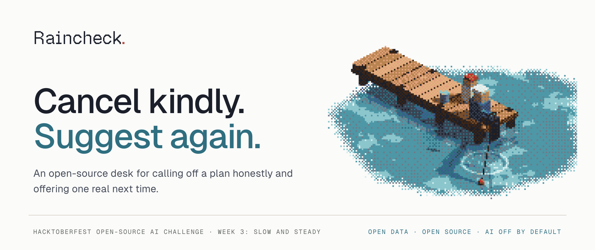
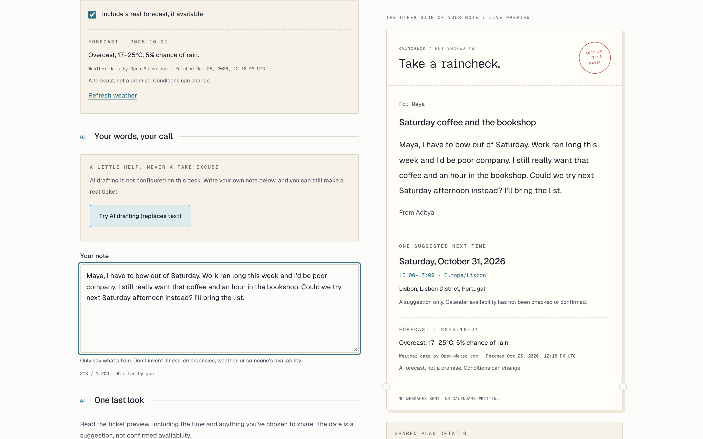
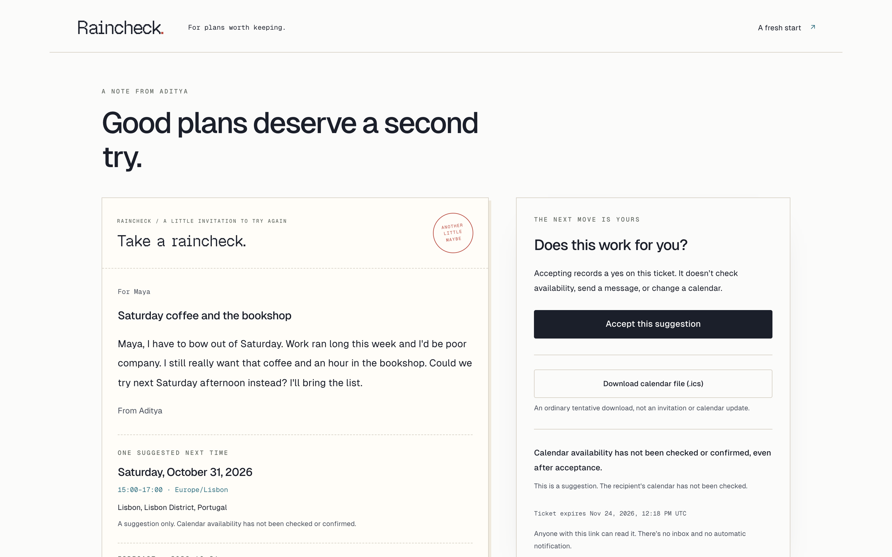
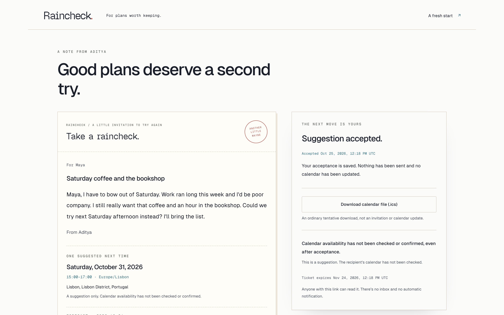
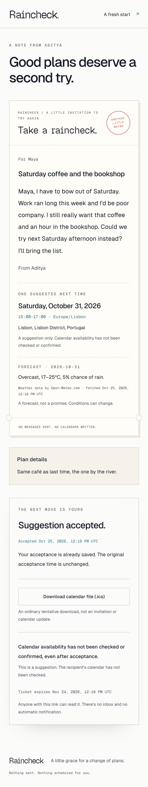
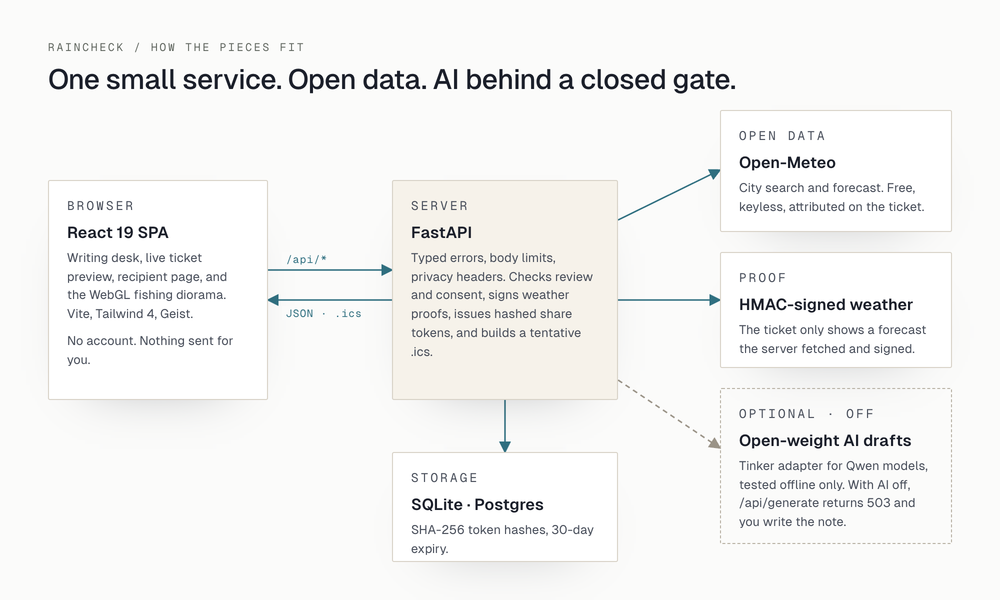
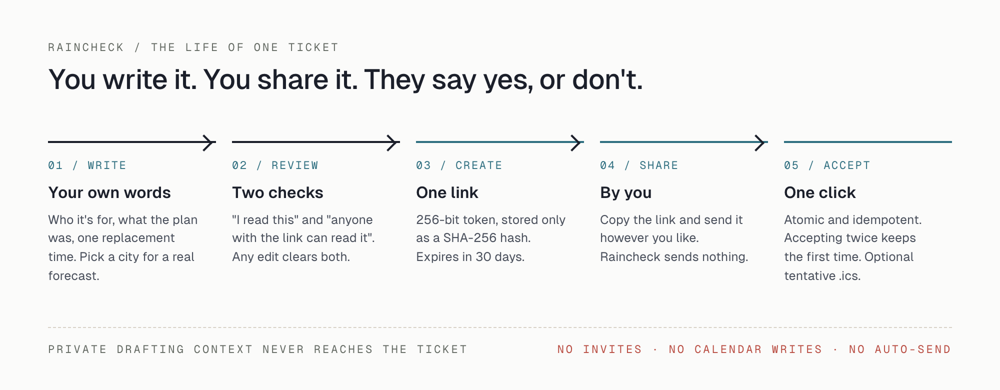

<p align="center">
  
</p>

<p align="center">
  <strong>A small, open-source desk for calling off a plan honestly and offering one real next time.</strong>
</p>

<p align="center">
  <a href="LICENSE"></a>
  
  
  
  
</p>

---

Raincheck turns an awkward cancellation into one kind note and one concrete replacement time. You write and review the note, then create an unguessable, expiring link and share it yourself. The recipient opens it, sees the note and an optional real forecast, and accepts with one click. There are no accounts, no automatic messages, and no calendar writes.

<p align="center">
  
</p>

## Contents

- [Features](#features)
- [How it works](#how-it-works)
- [Quick start](#quick-start)
- [Configuration](#configuration)
- [Testing](#testing)
- [Deployment](#deployment)
- [AI drafting](#ai-drafting)
- [Privacy and safety](#privacy-and-safety)
- [Project structure](#project-structure)
- [Project status](#project-status)
- [Contributing](#contributing)
- [License and credits](#license-and-credits)

## Features

- **Writing desk with live preview.** Recipient, plan, tone (Honest, Cozy, or a clearly labelled Theatrical joke), one replacement time, and your note. The ticket preview updates as you type.
- **Review before sharing.** Two explicit checks are required: you have read the current note, and you understand anyone with the link can read it. Any edit clears both.
- **Real forecasts, or none.** Optional city search and day forecast from [Open-Meteo](https://open-meteo.com/), with attribution and fetch time. The server signs each forecast summary, so a ticket can only show weather the server actually fetched.
- **Expiring share tickets.** 256-bit tokens stored only as SHA-256 hashes, with a 30-day default lifetime. Private drafting context is never sent with the ticket.
- **One-click acceptance.** Atomic and idempotent: concurrent or repeated accepts keep the first acceptance time.
- **Tentative calendar file.** An RFC 5545 `.ics` download with `STATUS:TENTATIVE`, no organizer, attendees, or invitation method, and UTF-8-safe line folding.
- **Honest AI boundary.** An open-weight model adapter (Qwen via Tinker) with strict prompt and output checks. It is off by default; the API returns `503 ai_unavailable` and the desk falls back to manual writing.
- **The fishing dock.** A WebGL, Bayer-dithered diorama on the landing page with pointer and keyboard input, pause control, offscreen pausing, a DPR cap, a reduced-motion still frame, and a WebGL fallback.
- **Accessible by default.** Visible focus styles, labelled controls, keyboard support, and `prefers-reduced-motion` support throughout.

| Recipient view | Accepted | Mobile |
| --- | --- | --- |
|  |  |  |

A 55-second narrated walkthrough is in [`blogs/assets/video/raincheck-demo.mp4`](blogs/assets/video/raincheck-demo.mp4).

## How it works

<p align="center">
  
</p>

- **Frontend:** React 19, TypeScript, Vite, Tailwind CSS 4, and locally bundled Geist Sans, Mono, and Pixel.
- **Backend:** FastAPI, Pydantic, and SQLAlchemy. SQLite locally; Postgres through `DATABASE_URL`.
- **Weather:** Open-Meteo geocoding and forecast APIs, keyless, on fixed hosts.
- **Serving:** in production, one container serves both the SPA and `/api/*` from the same origin.

<p align="center">
  
</p>

### API

| Method | Path | Purpose |
| --- | --- | --- |
| `GET` | `/api/health` | Service, database, and capability status |
| `GET` | `/api/locations/search?q=` | City search (Open-Meteo geocoding) |
| `GET` | `/api/weather` | Day forecast with a signed weather proof |
| `POST` | `/api/generate` | AI draft; `503 ai_unavailable` when AI is off |
| `POST` | `/api/tickets` | Create a reviewed ticket |
| `GET` | `/api/tickets/{token}` | Read a ticket |
| `POST` | `/api/tickets/{token}/accept` | Accept the suggestion (idempotent) |
| `GET` | `/api/tickets/{token}/raincheck.ics` | Tentative calendar file |

Request and response types live in `backend/app/schemas/` and `frontend/src/lib/api/types.ts`. Interactive docs are served at `/api/docs` in development.

## Quick start

### Prerequisites

- Node 22 LTS (see `.nvmrc`)
- [uv](https://docs.astral.sh/uv/) (installs the pinned Python 3.12)
- Docker, only if you want to build the container

### Install

```bash
git clone https://github.com/puri-adityakumar/raincheck.git
cd raincheck

# Optional: every value in .env.example is blank by default.
cp -n .env.example .env

(cd backend && uv sync --all-groups)
(cd frontend && npm ci)
```

No API key is needed. Manual writing and Open-Meteo weather work out of the box.

### Run in development

```bash
# Terminal 1: API on http://localhost:8000
cd backend
.venv/bin/uvicorn app.main:app --reload --port 8000 --no-access-log

# Terminal 2: UI on http://localhost:5173 (proxies /api to :8000)
cd frontend
npm run dev
```

### Run the production build locally

```bash
(cd frontend && npm run build)
cd backend && .venv/bin/uvicorn app.main:app --port 8000 --no-access-log
# open http://localhost:8000
```

## Configuration

All settings are environment variables, documented in `.env.example`, `frontend/.env.example`, and `backend/app/core/config.py`.

| Variable | Default | Notes |
| --- | --- | --- |
| `APP_ENV` | `development` | `development`, `test`, or `production` |
| `DATABASE_URL` | SQLite file in `backend/` | `postgres://` URLs are normalized for psycopg |
| `WEATHER_TOKEN_SECRET` | random per process in development | **Required in production**; startup fails if blank |
| `TICKET_TTL_DAYS` | `30` | 1 to 90 |
| `FRONTEND_ORIGIN` | `http://localhost:5173` | Development CORS only |
| `PUBLIC_BASE_URL` | `http://localhost:8000` | Public origin of the app |
| `ENABLE_API_DOCS` | `true` | Set `false` in production |
| `OPEN_METEO_BASE_URL` | `https://api.open-meteo.com` | Forecast host |
| `AI_PROVIDER` | `none` | `none` or `tinker` |
| `TINKER_ALLOW_PAID_INFERENCE` | `false` | Separate explicit gate for paid inference |
| `TINKER_API_KEY`, `TINKER_MODEL`, `TINKER_ADAPTER_PATH` | blank | Only read when both AI gates are open |
| `RAINCHECK_ALLOW_PAID_TRAINING` | `0` | Training tooling refuses to run regardless |
| `VITE_API_BASE_URL` | blank (same origin) | Frontend build-time API origin; omit `/api` |

Never commit `.env`, and never put secrets in `VITE_*` variables. `VITE_API_BASE_URL` accepts only plain HTTP(S) origins with an optional path prefix. Production stays same-origin and does not enable CORS through `FRONTEND_ORIGIN`.

> **Existing databases:** startup refuses older databases whose relationship constraint lacks `group`, and leaves the data untouched. `create_all` is not a migration. Point `DATABASE_URL` at a new database, or write a data-preserving migration first.

## Testing

```bash
./checks.sh
```

The check script needs no network, installs nothing, never calls Tinker, and never touches Git. It runs:

- a blank-value check on `.env.example`;
- `ruff check`, `ruff format --check`, and `pytest` for the backend;
- offline SDK-double tests for the AI adapter and its paid-execution guards;
- TypeScript, Vitest with Testing Library, and a production Vite build for the frontend.

The current suite has **332 passing tests** (234 backend, 32 adapter and tooling, 66 frontend). Temporary files stay in an ignored `.checks.*` directory that is removed on exit.

Run the parts individually:

```bash
cd backend && .venv/bin/ruff check app tests && .venv/bin/ruff format --check app tests && .venv/bin/pytest -q
cd frontend && npm run check && npm test && npm run build
```

## Deployment

### Docker

```bash
docker build -t raincheck .
WEATHER_TOKEN_SECRET="$(openssl rand -base64 32)" docker run --rm \
  -p 127.0.0.1:8000:8000 -e APP_ENV=production -e WEATHER_TOKEN_SECRET raincheck
```

The image builds the frontend in a Node 22 stage and runs FastAPI on Python 3.12 as a non-root user. It honors `PORT`, ships a health check, and disables access logs so share tokens in URLs are not written to stdout.

### Render

`render.yaml` defines one Docker web service and one Postgres database. Render injects `DATABASE_URL` and generates `WEATHER_TOKEN_SECRET`; no secrets live in the repository. Auto-deploy is off.

Before running it as a public service:

- verify ticket creation, concurrent acceptance, and `.ics` downloads against live Postgres;
- add rate limiting;
- redact `/t/…` and `/api/tickets/…` paths in platform and proxy logs.

## AI drafting

AI drafting is **off by default and has not run against a live model.**

The adapter in `backend/app/services/generation/` targets small open-weight models through the [Tinker](https://thinkingmachines.ai/tinker/) sampling API: `Qwen/Qwen3-8B`, `Qwen/Qwen3.5-4B`, or `Qwen/Qwen3.5-9B`, with an optional `tinker://` fine-tuned adapter path. It is designed to fail safe:

- Inference needs `AI_PROVIDER=tinker`, `TINKER_ALLOW_PAID_INFERENCE=true`, credentials, a supported model, and the pinned SDK from `requirements-tinker.txt`. A key alone never turns it on.
- The prompt treats every user field as data and forbids invented illness, emergencies, history, urgency, calendar access, or availability. Weather may only be quoted from the signed summary.
- Output is Unicode-normalized and rejected if it contains Markdown or HTML, medical claims, availability claims, or weather outside the signed summary.
- Replies are capped at 256 tokens, two requests run at a time, and paid calls are never retried automatically.
- A passing draft still goes through the same human review and consent before it can become a ticket.

Training tooling in `scripts/` defaults to dry runs and refuses paid execution. See [`scripts/README.md`](scripts/README.md) and [`public-docs/tinker-notes.md`](public-docs/tinker-notes.md).

## Privacy and safety

- Nothing is sent on your behalf. You share the link yourself.
- Share tokens are hashed at rest and expire. Anyone holding a link can read that ticket, and the UI says so before creating one.
- Coordinates, prompts, and private drafting context never appear in public responses.
- No attendee fields, invitations, or calendar writes. Suggested times are never presented as confirmed availability.
- Request IDs, body-size limits, typed errors, and privacy headers on every response. Ticket pages are marked `noindex`.

## Project structure

```text
frontend/      React app: landing, composer, recipient page, diorama, typed API client
backend/       FastAPI app: locations, weather, generation, tickets, ICS; pytest suite
scripts/       Offline AI adapter tests and guarded dataset, training, and evaluation tools
public-docs/   Provenance and AI/Tinker notes
blogs/         DEV write-up, screenshots, diagrams, and the demo video
Dockerfile     Node build stage + Python runtime serving SPA and API
render.yaml    Render blueprint: one web service + Postgres
checks.sh      Offline lint, type, test, and build checks
```

## Project status

Raincheck is an MVP that runs locally end to end with real Open-Meteo weather. It is not yet deployed.

- [x] Writing desk, review and consent gate, share tickets, acceptance, and `.ics`
- [x] Open-Meteo search and signed forecasts
- [x] Offline-tested open-weight AI adapter, off by default
- [x] Docker image and Render blueprint
- [ ] Hosted deployment with live Postgres, rate limits, and log redaction
- [ ] Live AI drafting with a measured quality check
- [ ] Fine-tuned model on a small, consented dataset, compared against a baseline
- [ ] Data-preserving database migrations

## Contributing

Issues and pull requests are welcome. Before opening a PR:

1. Run `./checks.sh` and make sure it passes.
2. Add a regression test with each behavior change.
3. Keep the product rules intact: no automatic messages, no calendar writes, no invented weather or availability, and Theatrical tone always labelled as a joke.
4. Never commit secrets, `.env` files, databases, or datasets.

## License and credits

Raincheck is released under the [MIT License](LICENSE).

- Weather data by [Open-Meteo.com](https://open-meteo.com/) under CC BY 4.0, attributed on every forecast and ticket.
- Geist Sans, Geist Mono, and Geist Pixel by The Geist Project Authors, OFL-1.1, bundled via Fontsource.
- The fishing dock diorama is an original work by the author, ported to React. Provenance details are in [`public-docs/provenance.md`](public-docs/provenance.md).
